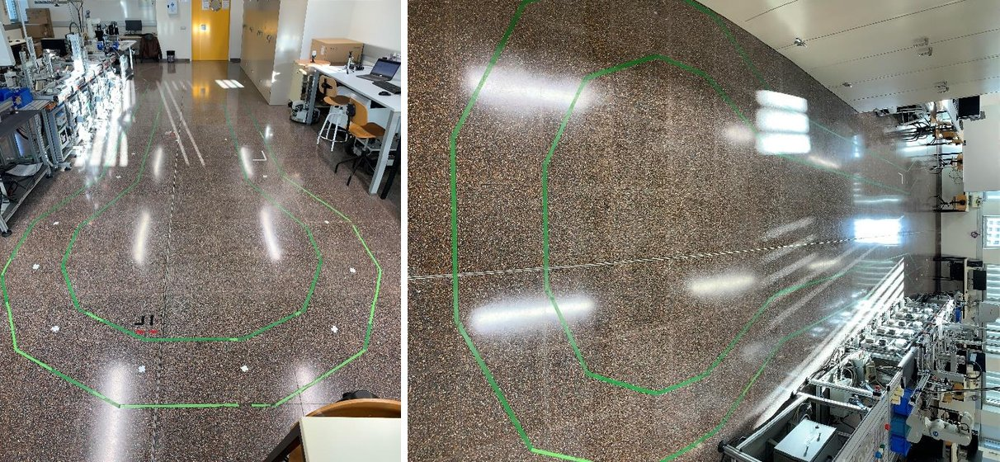
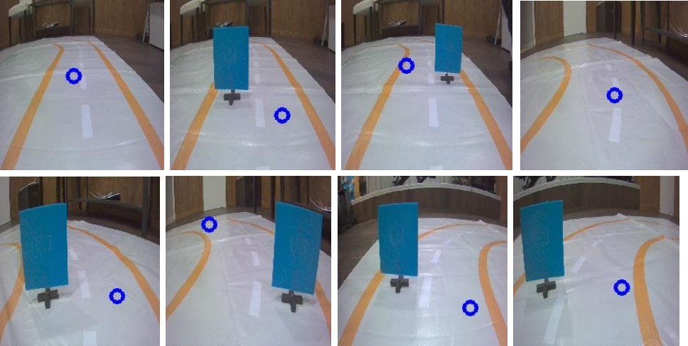
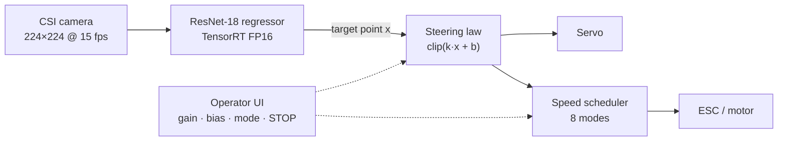
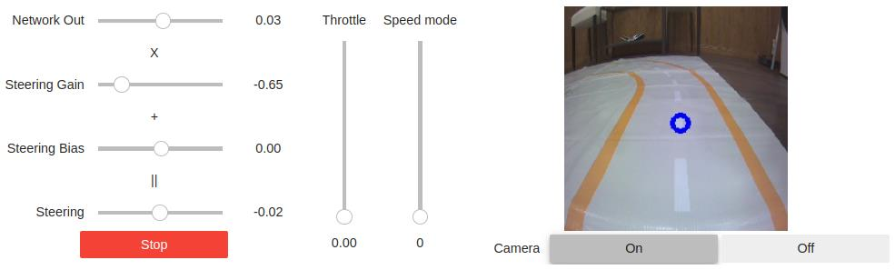
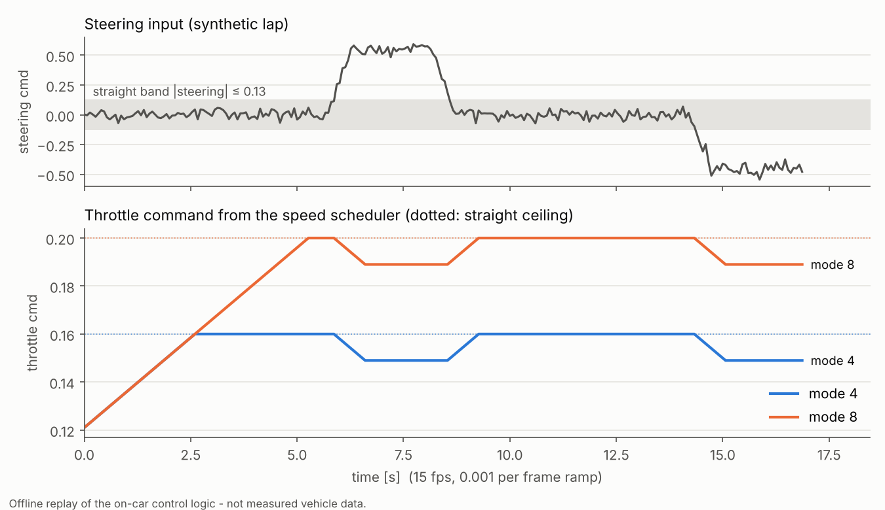

# Vision-Based Autonomous RC Car on Jetson Nano

**End-to-end camera-only driving with a ResNet-18 regressor, TensorRT inference and a steering-scheduled speed controller.**
Bachelor's thesis, Electrical Engineering, Universitat Politècnica de Catalunya (UPC-EEBE), January 2023.

[](https://github.com/albertsagre/jetracer-autonomous-driving/actions/workflows/ci.yml)
%20%7C%203.9%2B%20(tests)-3776AB)


<p align="center">
  
  
</p>

## Summary

A 1:10 RC car (Waveshare JetRacer Pro) drives a taped indoor circuit **without human input**, using a single
CSI camera and a neural network running on an NVIDIA Jetson Nano. It follows the track, slows down for
corners, speeds up on straights, steers around obstacles, and streams every control variable to a live
operator dashboard with an emergency stop.

Starting from NVIDIA's open-source JetRacer examples, I built four iterations of the driving stack, each
driven by problems found in track testing:

| | Iteration 1 | Iteration 2 | Iteration 3 | Iteration 4 |
|---|---|---|---|---|
| **Added** | Baseline: own dataset, TensorRT FP16 | Event-driven loop, live tuning UI, manual speed | Steering-based speed control, camera ISP fix | 8 speed modes, emergency stop, live prediction overlay, obstacle avoidance |
| **Training data** | 830 frames | 3,055 | 4,966 | 6,180 |
| **Training (on Nano)** | 18 min | 1 h 29 min | 2 h 24 min | 2 h 56 min |

→ Details: [system overview](docs/system-overview.md) · [iterations and findings](docs/iterations.md) ·
[code review / known issues](docs/known-issues.md) · [setup](docs/setup.md) ·
[full thesis (Catalan, with EN abstract)](docs/thesis/TFG_Albert_Sagre_Martinez_2023_CA.pdf)

## How it works



- **Perception (end-to-end):** the operator labels each frame by clicking the point the car should drive
  towards. A ResNet-18 (ImageNet pre-trained, last layer → 2 outputs) learns to regress that point; obstacle
  avoidance is learned the same way, from frames where the target passes beside a blue panel.
- **Lateral control:** proportional law on the horizontal look-ahead coordinate, `steering = clip(k·x + b)`,
  with gain and bias tuned live on the track.
- **Longitudinal control:** a rate-limited speed scheduler. On straights (|steering| ≤ 0.13) the throttle
  ramps up to the mode's ceiling; in corners it ramps down to the mode's floor. Hard limit 0.2, arming
  interlock below 0.11, ramp 0.001 per frame (≈ 5 s from launch to full speed).

<p align="center">
  
  <br><em>Operator dashboard (iteration 4): network output → gain/bias → steering, throttle, speed mode, STOP, live view.</em>
</p>

## Engineering highlights

- **Real-time performance debugging.** After moving to a live-tuning UI the car steered late and drifted on
  straights. I traced it to the Nano not keeping up with 30 fps plus UI updates; dropping the camera to
  15–20 fps gave fresher frames and a faster, more accurate response.
- **Data over model.** The biggest gains came from the dataset: balancing left/right turns (an unbalanced set
  drove better in one direction), adding varied obstacle positions and lighting, and growing from 830 to
  6,180 labelled frames.
- **Sensor issue fixed at the source.** Diagnosed the IMX219 colour cast and vignetting and installed the
  camera ISP override instead of compensating in the model.
- **Safety by design.** Bounded throttle range, arming interlock, speed mode 0 and an emergency stop button,
  added once automatic speed control made the car harder to stop.
- **Refactored and verified (2026).** The on-car speed logic, originally a 60-line `if/elif` chain inside a UI
  callback, is extracted into a table-driven pure function in [`src/jetracer_control`](src/jetracer_control).
  Tests compare it against a **verbatim copy of the on-car code** on 200,000 random inputs and on closed-loop
  sequences, so the refactor is proven behaviour-equivalent. CI runs lint and tests on every push.

<p align="center">
  
  <br><em>Offline replay of the on-car speed logic on a synthetic steering trace (not measured vehicle data).</em>
</p>

## Retrospective: what I would do differently

Revisiting this project after working in vehicle calibration and software validation, in order of priority:

1. **Make the emergency stop independent of perception.** In the archived code STOP only takes effect inside
   the camera callback, so a stalled perception loop would leave the last throttle applied
   ([issue #1](docs/known-issues.md)). STOP should command the actuator directly, with a frame-age watchdog.
2. **Measure, don't eyeball.** Add a held-out validation split (by recording session) and track KPIs such as
   interventions per lap and lap time, so iterations can be compared objectively.
3. **Train off-board.** Training on the Nano took up to 3 h per run; a desktop GPU would turn that into
   minutes and allow far more test loops per day. Keep the Nano for TensorRT inference only.
4. **Use the full look-ahead point.** The network already predicts `(x, y)`; a pure-pursuit-style lateral law
   and a curvature-based speed target would start braking *before* the corner, instead of reacting to the
   steering angle once in it.
5. **Log everything for replay.** Record frames, predictions and commands so control changes can be tested
   offline before going back to the track.

## Repository structure

```
├── notebooks/                  # As run on the car (Jupyter, JetPack 4.5.1)
│   ├── 01_basic_motion.ipynb               upstream: actuator check
│   ├── 02_teleoperation.ipynb              upstream: gamepad driving
│   ├── 03_interactive_regression.ipynb     upstream: data labelling + ResNet-18 training
│   ├── 04_road_following_v1_baseline.ipynb upstream: TensorRT conversion + baseline loop
│   ├── 05_road_following_v2_manual_speed.ipynb       mine
│   ├── 06_road_following_v3_dynamic_throttle.ipynb   mine
│   └── 07_road_following_v4_speed_modes.ipynb        mine (final)
├── src/jetracer_control/       # Hardware-independent control logic (refactored, tested)
├── tests/                      # Unit tests + equivalence tests vs. the on-car code
├── scripts/                    # Offline simulation / plots
├── docs/                       # System overview, iterations, known issues, setup, thesis PDF
└── .github/workflows/ci.yml
```

Upstream notebooks come from [NVIDIA-AI-IOT/jetracer](https://github.com/NVIDIA-AI-IOT/jetracer) (MIT) and
each one states its provenance in its first cell; see [NOTICE.md](NOTICE.md) for what is mine and what is not.

## Quick start

On a PC (no hardware needed):

```bash
git clone https://github.com/albertsagre/jetracer-autonomous-driving.git
cd jetracer-autonomous-driving
pip install -e ".[dev]"
pytest -q
python scripts/simulate_speed_scheduler.py
```

On the car: see [docs/setup.md](docs/setup.md).

## Thesis

**Conducció d'un vehicle autònom mitjançant tècniques d'intel·ligència artificial**
(*Driving an autonomous vehicle using artificial intelligence techniques*)
Albert Sagré Martínez · Supervisors: Joaquim Blesa Izquierdo, Pedro Ponsa Asensio ·
Bachelor's Degree in Electrical Engineering, UPC-EEBE, January 2023.
[PDF](docs/thesis/TFG_Albert_Sagre_Martinez_2023_CA.pdf) (Catalan; abstract in Catalan, Spanish and English).

## Author

**Albert Sagré Martínez**: systems engineer working on vehicle software validation, moving into
autonomy, control and robotics.
[LinkedIn](https://www.linkedin.com/in/albert-sagre)

## License

Code: [MIT](LICENSE). Thesis document and images: © Albert Sagré Martínez. Upstream notebooks: MIT, see [NOTICE.md](NOTICE.md).
