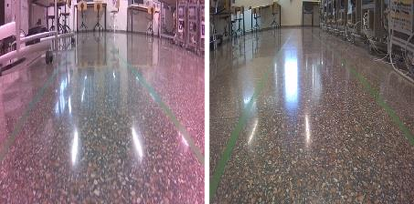

# Development iterations

The project followed short agile sprints. Each iteration was tested first on the home track and then on
the lab circuit at EEBE (UPC); the problems found on the track defined the next iteration.

## Training data and cost per iteration (Jetson Nano, on-board training)

| Iteration | Labelled frames | Epochs | Time / epoch | Total training time |
|---|---:|---:|---:|---:|
| 1 | 830 | 10 | 1 min 48 s | 18 min |
| 2 | 3,055 | 15 | 5 min 56 s | 1 h 29 min |
| 3 | 4,966 | 15 | 9 min 38 s | 2 h 24 min |
| 4 | 6,180 | 20 | 11 min 47 s | 2 h 56 min |

Training time per epoch scales roughly linearly with dataset size (~0.12 s per frame per epoch on the
Nano). By iteration 4 a single training run took about 3 h, which directly limited how many test
loops fit in a day; this is the main argument for training off-board on a desktop GPU (see README,
retrospective).

## Iteration 1 · Baseline

- Upstream `road_following` notebook with my own dataset and a TensorRT FP16 model.
- **Found:** the first datasets were too small to drive reliably; the car only ran at a fixed throttle
  set before starting, and could only be stopped by re-running the cell with throttle 0.

## Iteration 2 · Event-driven loop and manual speed control

- Replaced the blocking `while True` loop with a camera callback so the UI stays live while driving.
- Control panel: network output, gain, bias, steering and throttle (bounded to 0–0.2).
- **Found:** a dataset with more turns in one direction biased the car (it drove better one way round
  the track) → rebalanced the data.
- **Found:** with the extra UI work in the loop the car steered late and drifted on straights. Root
  cause: the Nano could not keep up with 30 fps plus widget updates. **Fix:** reduce the camera to
  15–20 fps; fewer but fresher frames gave a faster, more accurate response.

## Iteration 3 · Dynamic throttle

- First speed scheduler: speed up when |steering| ≤ 0.3, slow down when above, within a fixed band.
  Thresholds were informed by asking the Formula Student driverless team (Formula Edge) how they
  approach speed planning.
- **Found:** with automatic throttle, stopping the car became harder → an explicit emergency stop is
  required (done in iteration 4).
- **Found:** colour cast / vignetting on the IMX219 images. **Fix:** installed the camera ISP override
  file for the sensor, which corrected the images.

  

- **Found:** glare from the polished lab floor and direct light caused wrong predictions and near
  collisions. Proposed fix (not implemented, hardware not available): anti-glare/polarising filter.

## Iteration 4 · Speed modes, emergency stop, live prediction, obstacles

- 8 speed modes with separate straight ceilings and corner floors, finer 0.001 ramp and tighter
  straight threshold (0.13). Ramp only engages above 0.11 (arming interlock).
- STOP button and speed mode 0 both force zero throttle.
- Live camera view with the predicted target point.
- Dataset extended with obstacle scenes (blue panels in different positions and lighting) so the car
  steers around them.
- **Found:** too many examples of one obstacle configuration biases the model; variety of positions and
  visibility matters more than raw count.

*Predicted target points with obstacles in the lane. Note: the overlay in this notebook version plots
`(x, x)` instead of `(x, y)` (see [known issues](known-issues.md)); the steering only uses `x`, which is
correct.*

## Capability summary

| Capability | It. 1 | It. 2 | It. 3 | It. 4 |
|---|:-:|:-:|:-:|:-:|
| Track following | ✓ | ✓ | ✓ | ✓ |
| Live view of control variables |  | ✓ | ✓ | ✓ |
| Manual speed control |  | ✓ | ✓ | ✓ |
| Automatic speed control |  |  | ✓ | ✓ (8 modes) |
| Emergency stop |  |  |  | ✓ |
| Live prediction overlay |  |  |  | ✓ |
| Obstacle avoidance |  |  |  | ✓ |
