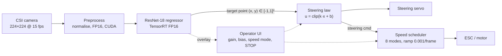
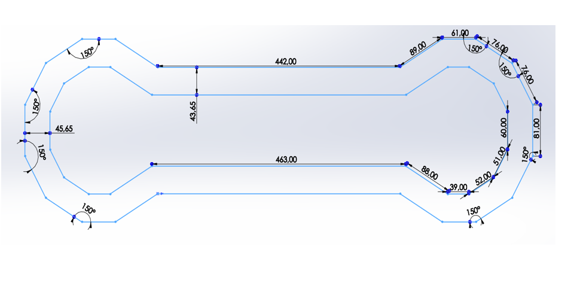

# System overview

## Problem statement

Drive a 1:10 RC car around a taped indoor track **using only a monocular camera and a neural network**:
no LiDAR, no radar, no lane-detection hand-tuned pipeline. Requirements from the thesis:

1. Follow the track without human intervention.
2. Regulate speed autonomously (slow in corners, faster on straights).
3. Avoid static obstacles placed on the track.
4. Give the operator live supervision of all control variables and an emergency stop.

## Hardware

| Item | Specification |
|---|---|
| Platform | Waveshare JetRacer Pro AI Kit (1:10 RC chassis, ESC + steering servo, OLED status display) |
| Compute | NVIDIA Jetson Nano 4 GB: quad-core Cortex-A57, 128-core Maxwell GPU, ~472 GFLOPS (FP16), 5–10 W |
| Sensor | CSI camera, Sony IMX219, wide-angle lens; frames resized to 224 × 224 |
| Operator link | Wi-Fi → JupyterLab in the browser; Bluetooth gamepad for teleoperation |
| Cost | 455 € (kit only) |

Compute platform was chosen after comparing Jetson Nano, Jetson AGX Xavier, Jetson TX2i, Google Coral
and Raspberry Pi 4 on cost, power, CUDA/TensorRT support and community material (thesis ch. 4).

## Software stack

Ubuntu 18.04 / JetPack 4.5.1 · Python 3.6 · PyTorch + torchvision · `torch2trt` / TensorRT (FP16) ·
OpenCV · JupyterLab + ipywidgets/traitlets · NVIDIA `jetracer` and `jetcam` libraries.

## Pipeline



### Perception: end-to-end target-point regression

The network does not detect lanes explicitly. During data collection the operator places the car on the
track and **clicks the point in the image the car should drive towards**; the frame and the click
`(x, y)` are stored. A ResNet-18 pre-trained on ImageNet has its final layer replaced by a
`Linear(512, 2)` and is fine-tuned on these pairs with an MSE loss (Adam, batch 8). Augmentation:
colour jitter (brightness, contrast, saturation, hue = 0.2) and random horizontal flip (with the x label
mirrored), which also helps balance left/right turns.

For obstacle avoidance the same mechanism is used: in frames containing a blue panel the operator
clicks a target point that passes beside it, so avoidance is learned as part of the same regression.

ResNet-18 was chosen over AlexNet, SqueezeNet, ResNet-34 and DenseNet-121 as the best trade-off between
representational capacity and training/inference cost on the Jetson Nano (thesis §5.3–5.4). The trained
model is converted to a TensorRT engine with `torch2trt` in FP16 for inference.

### Lateral control

Only the horizontal component of the target point is used:

```
steering = clip(gain · x + bias, -1, 1)        gain ≈ -0.65 (sign from servo orientation)
```

This is a static proportional law on the look-ahead point. Tuning rules used on the track: lower the
gain if the car oscillates, raise it if it misses corners, adjust the bias if it drifts to one side.

### Longitudinal control: speed scheduler (iteration 4)

Called once per frame; see [`src/jetracer_control/speed_scheduler.py`](../src/jetracer_control/speed_scheduler.py).

| Condition | Action |
|---|---|
| Mode 0 or STOP pressed | throttle = 0 |
| \|steering\| ≤ 0.13 and 0.11 < throttle < ceiling(mode) | throttle += 0.001 |
| \|steering\| > 0.13 and throttle > floor(mode) | throttle −= 0.001 |
| otherwise | hold |

| Mode | 1 | 2 | 3 | 4 | 5 | 6 | 7 | 8 |
|---|---|---|---|---|---|---|---|---|
| Straight ceiling | 0.14 | 0.15 | 0.15 | 0.16 | 0.17 | 0.18 | 0.19 | 0.20 |
| Corner floor | 0.12 | 0.13 | 0.14 | 0.15 | 0.16 | 0.17 | 0.18 | 0.19 |

Design notes:

- **Hard safety limit**: the throttle slider is bounded to 0–0.2 in normalised units (the car is fast;
  ~0.12 is the threshold at which it starts moving with a charged battery).
- **Arming interlock**: the scheduler never accelerates from below 0.11, so the operator must give an
  initial throttle deliberately before the controller takes over.
- **Rate limiting**: 0.001 per frame at 15 fps = 0.015 /s, so a full ramp from 0.12 to 0.20 takes ~5 s
  and avoids wheel-spin and abrupt load changes.


*Offline replay of the exact on-car logic on a synthetic steering trace: `python scripts/simulate_speed_scheduler.py`.*

### Operator interface

Built with ipywidgets and traitlets links so every variable can be watched and tuned while the car drives:
network output, steering gain, steering bias, resulting steering, throttle, speed mode, emergency stop and
a live camera view with the predicted target point.


## Test environments

| Track | Description |
|---|---|
| Home | Waveshare printed mat (oval) |
| Lab 5.4, EEBE (UPC) | Taped "dog-bone" circuit on a polished terrazzo floor: two ~4.5 m straights, ~44 cm lane width, polygonal hairpins (150° segments). Reflective floor and direct sunlight make it harder for a camera-only system |


